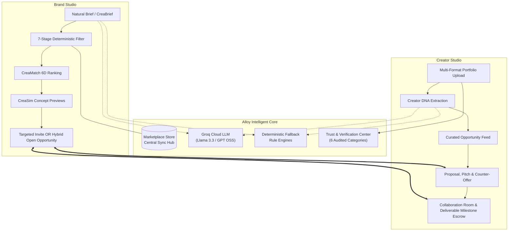

# ALLOY — The Creative Infrastructure for the Generative Economy
## Evidence-Based Startup Investment & Hackathon Pitch

> **Platform Overview:** Alloy (powered by the CreaSync Creative Intelligence Engine) is an AI-native marketplace and collaboration operating system bridging enterprise brands with elite generative AI visual directors, 3D artists, and visual technologists. Alloy replaces subjective keyword searches and vanity metrics with **Explainable Creative Intelligence**, **Deterministic Requirement Enforcement**, **Verified Provenance**, and **Milestone-Governed Production Handoff**.

---

## 1. Executive Summary & Elevator Pitch

The creative industry is undergoing a generational rupture. The emergence of diffusion models, neural rendering, and multimodal video generation has transformed commercial media: brands can now conceptualize photorealistic, cinematic campaigns in hours rather than months. Yet, enterprise adoption remains paralyzed by a fundamental trust and workflow gap. 

Brands struggle to articulate technical generative briefs, waste weeks vetting creators through unverified portfolio screenshots, face severe intellectual property and commercial licensing risks, and manage projects through disjointed emails and messaging apps.

**Alloy solves this end-to-end:**
1. **Intelligent Campaign Briefing (CreaBrief):** Converts unstructured natural-language brand concepts into machine-readable, structured production briefs using high-speed Groq LLMs with deterministic fallbacks.
2. **Deterministic Candidate Vetting:** A 7-stage server-side pipeline strictly enforces mandatory constraints (skills, 3D toolchains, deliverable aspect ratios, commercial licensing clearance, portfolio thresholds) with transparent exclusion ledgers before any ranking occurs.
3. **Explainable Style Matching (CreaMatch & Creator DNA):** A 6-dimensional algorithmic engine calculates 0–100% compatibility scores and outputs transparent, portfolio-grounded citations explaining *why* a creator fits.
4. **Pre-Hire Simulation (CreaSim):** Synthesizes concrete directorial concepts and visual treatments *before* a brand contracts a creator or commits capital.
5. **End-to-End Collaboration Handoff:** Dual purpose-built studios (Brand Studio & Creator Studio) governing the entire lifecycle from hybrid marketplace applications to milestone deliverables review, versioning, threaded messaging, and verified escrow payments.

---

## 2. Problem Statement & Market Opportunity

```
┌────────────────────────────────────────────────────────────────────────────────┐
│                          THE COMMERCIAL CREATIVE CRISIS                        │
├───────────────────────────────┬────────────────────────────────────────────────┤
│ The Brand Dilemma             │ The Elite Creator Dilemma                      │
├───────────────────────────────┼────────────────────────────────────────────────┤
│ • Content Velocity Crisis:    │ • Discovery Invisibility: Lost in generic      │
│   Omni-channel marketing      │   gig platforms (Upwork/Fiverr) competing on   │
│   requires 10x asset volume.  │   race-to-the-bottom hourly pricing.           │
│ • Production Timelines:       │ • Vanity Metric Irrelevance: High-craft visual │
│   Traditional 6-12 week shoot │   technologists lack millions of social media  │
│   cycles costing $50K–$250K+  │   followers required by influencer platforms.  │
│   are unviable.               │ • Brief Ambiguity: Forced to interpret vague,  │
│ • Commercial & IP Risk:       │   contradictory brand briefs without clear     │
│   Fear of copyright violation │   licensing terms, leading to unpaid revisions.│
│   and unverified AI tools.    │ • Scope Creep & Late Payouts: Zero milestone   │
│ • Scouting Friction: Weeks    │   protection or structured deliverable         │
│   lost to manual DM scouting. │   governance.                                  │
└───────────────────────────────┴────────────────────────────────────────────────┘
```

### The Market Opportunity
* **Generative AI in Marketing & Creative Industries:** Evaluated at **$4.5B–$6.5B**, expanding at a Compound Annual Growth Rate (CAGR) of **30%–35%**, tracking toward **$20B–$22B+** by the early 2030s.
* **The Creator Economy Expansion:** Over 85% of commercial creators and marketers actively integrate generative workflows into daily operations. Independent directors can now execute multi-camera CGI loops, surreal editorial photography, and 4K video masters previously requiring multi-million dollar studio budgets.
* **The Missing Layer:** While generative tools (Runway Gen-3, Midjourney v6, ComfyUI, Flux, Luma Dream Machine) proliferate rapidly, **there is zero transaction and collaboration infrastructure designed specifically for commercial generative engagements**.

---

## 3. Solution & Product Overview

Alloy provides the missing operational infrastructure through two synchronized workspaces connected by an intelligent matching and governance engine:



---

## 4. Key Features & Dual User Journey

### A. The Brand Experience (Brand Studio)
The Brand Studio features 9 cohesive operational views built for enterprise creative directors and campaign managers:
1. **Studio Overview:** Real-time visibility into campaign velocity, active deliverables, pending invitations, and fast-start actions (Create from Scratch, Structure with Alloy Brief AI, Discover Verified Creators).
2. **Campaign Manager:** Full lifecycle management (Draft, Active, Completed, Archived). Supports multi-slot capacity (e.g., commissioning 3 distinct creators for one campaign), target platforms (Instagram, TikTok, Digital OOH, YouTube), and budgets.
3. **AI Natural-Language Campaign Filter (Discover View):** Brands express campaign needs in unformatted plain text. The system parses requirements, filters eligible creators, and provides interactive suggestions (e.g., *"Find creators who can produce cinematic vertical AI videos for a premium skincare launch. Commercial usage rights are required."*).
4. **Transparent Match Breakdown (Why This Creator?):** Side-by-side dimensional scores detailing exact points scored in style alignment, format compatibility, and verified past client evidence.
5. **CreaSim Pre-Visualization:** Generates 3 concrete collaborative campaign treatments (visual hook, aesthetic execution framework, and moodboard still) *prior* to sending an invitation.
6. **Collaboration Room:** Milestone tracking, high-definition preview player with zoom/pan, contextual feedback threads, deliverable revision requests, and one-click deliverable approval.
7. **Secure Escrow Payments (Razorpay Standard Web Checkout):** Direct in-app milestone funding secured with HMAC-SHA256 cryptographic signatures.

### B. The Creator Experience (Creator Studio)
The Creator Studio provides an editorial, portfolio-first workspace for generative artists:
1. **Multi-Format Portfolio Engine:** Drag-and-drop uploader supporting mixed-media case studies:
   - High-resolution imagery (`JPG`, `PNG`, `WebP`, `GIF` up to 25MB).
   - Cinematic motion loops and master reels (`MP4`, `WebM`, `MOV` up to 100MB) with native letterbox-free HTML5 video playback.
2. **Creator DNA Dossier:** Three-tier provenance synthesis highlighting:
   - *Declared:* Stated specialty, turnaround times, day rates, platform availability.
   - *Supported:* Formats, aspect ratios (16:9, 9:16, 1:1), and client categories verified from portfolio files.
   - *AI-Inferred:* Lighting physics (e.g., *Subsurface scattering, 3200K tungsten*), tactile materials, camera movements, and tonal signatures.
3. **Hybrid Opportunity Marketplace:** Creators discover public brand campaigns, review strict eligibility criteria, and submit custom applications with pitch concepts, turnaround proposals, and counter-offers.
4. **Trust & Verification Center:** 6 audited credibility categories eliminating fake scores:
   - Account and email authentication.
   - Portfolio evidence with raw production artifacts (e.g., `.blend` files, ComfyUI node workflows, layered PSDs).
   - Disclosed AI tools (Midjourney, Runway Gen-3, Stable Diffusion, Cinema 4D).
   - Workflow verification steps.
   - Platform milestone delivery history.
   - Statutory commercial rights & model clearance declarations.
5. **Commercial Licensing Governance:** Creators specify custom licensing terms (Exclusive Buyout, Non-Exclusive License, permitted marketing channels, geographical territory, and usage duration).

---

## 5. AI Innovation & Competitive Advantage (Under the Hood)

Alloy does not rely on generic, black-box AI wrappers. Its intelligence architecture is strictly bifurcated into **Generative Cognitive Layers** and **Deterministic Enforcement Engines**.

```
┌────────────────────────────────────────────────────────────────────────────────────────┐
│                                DUAL-ENGINE ARCHITECTURE                                │
├───────────────────────────────────────────┬────────────────────────────────────────────┤
│ Live Groq Cloud Engine                    │ Deterministic Rule Engine (src/intelligence)│
├───────────────────────────────────────────┼────────────────────────────────────────────┤
│ • LLaMA 3.3 70B & GPT-OSS 120B            │ • Zero external network dependencies.      │
│ • Sub-second JSON inference               │ • 10+ visual style taxonomy engines.       │
│ • Structured brief parsing & synthesis    │ • Mathematical 6-dimensional scoring.      │
│ • Natural-language prompt disambiguation  │ • Guarantees 100% platform functionality   │
│ • RFC-8259 strict JSON schema enforcement │   even in complete offline/air-gapped state.│
└───────────────────────────────────────────┴────────────────────────────────────────────┘
```

### The 7-Stage Deterministic Filtering Pipeline (`server/filteringPipeline.js`)
Before any creator is scored or ranked, they must pass an unbending server-side pipeline:
* **Stage 1 (Brief Normalization):** Separates hard mandatory constraints from ranking preferences.
* **Stage 2 (Skills & Capabilities Verification):** Matches core competencies (e.g., *AI Video Production, 3D CGI Modeling*).
* **Stage 3 (Creative Specialization Verification):** Ensures exact domain match (e.g., *Luxury & Fashion, Skincare*).
* **Stage 4 (AI Toolchain Compatibility):** Confirms required models and rendering engines.
* **Stage 5 (Format & Aspect Ratio Verification):** Validates master deliverable capabilities (e.g., *9:16 vertical video*).
* **Stage 6 (Commercial Licensing Clearance):** Rejects creators without verified commercial usage rights.
* **Stage 7 (Portfolio Evidence Threshold):** Verifies minimum authentic project proof.
* **Exclusion Ledger:** Candidates that fail any stage are categorized into a transparent Exclusion Ledger with explicit human-readable reasons (e.g., `COMMERCIAL_LICENSING_UNVERIFIED`, `TOOL_CHAIN_INCOMPATIBLE`), completely preventing biased or unexplainable candidate loss.

### The 6-Dimensional CreaMatch Mathematical Engine (`matchingEngine.js`)
Candidates that pass all mandatory filters are ranked based on a transparent 100-point algorithm:

$$\text{CreaScore} = S_{\text{Style}} (25) + S_{\text{Portfolio}} (25) + S_{\text{Format}} (15) + S_{\text{Industry}} (15) + S_{\text{Platform}} (10) + S_{\text{Availability}} (10)$$

```
                                  CREAMATCH 100-POINT RADAR
                             [1. Creative Style Alignment]
                                      25 Points
                                         /\
                                        /  \
     [6. Availability & Budget]        /    \       [2. Portfolio Evidence]
             10 Points                /      \             25 Points
                     \               /        \               /
                      \-------------+----------+-------------/
                       \            |          |            /
                        \           |          |           /
                         \----------+----------+----------/
                        /            \        /            \
                       /              \      /              \
      [5. Platform Alignment]          \    /       [3. Format Compatibility]
             10 Points                  \  /               15 Points
                                         \/
                            [4. Industry Experience Fit]
                                     15 Points
```

---

## 6. Competitor Comparison

| Capability / Metric | Alloy (CreaSync) | Traditional Freelance (Upwork / Fiverr Pro) | Influencer Platforms (Grin / CreatorIQ) | Boutique Creative Reps (Agencies) | Generative Hubs (Civitai / PromptBase) |
|---|---|---|---|---|---|
| **Matching Mechanism** | **Deterministic 7-Stage Pipeline + 6D Style DNA** | Keyword search & low-bid competition | Follower count & social vanity metrics | Manual creative director Rolodex | Uncurated community prompt scrapers |
| **Aesthetic Intelligence** | **Deep visual trait extraction (lighting, camera, mood)** | None (resume text only) | None (social engagement only) | High, but human-bottlenecked (slow) | None (raw image gallery only) |
| **Commercial Licensing** | **Audited commercial rights & usage grants taxonomy** | Generic, unverified contracts | Vague influencer post terms | Expensive customized agency legal add-ons | High legal risk / Unvetted training IP |
| **Pre-Hire Simulation** | **CreaSim AI Collaborative Concept Treatments** | None (requires paid spec work) | None | High-cost agency pitch decks | None |
| **Turnaround Time** | **Minutes (Brief → Match → Invitation)** | Days (Posting → Bid sorting) | Weeks (Scouting → DM outreach) | 3–6 Weeks (Scouting → Contracting) | Immediate (Asset only, no creator) |
| **Platform Take-Rate** | **10%–15% Brand / 5% Creator** | Up to 20% + processing | Expensive Annual SaaS ($20K–$50K/yr) | 20%–40% Agency markup | 20% asset commission |
| **Production Workspace** | **Milestone review, high-res player, versioning** | Generic text messaging & zip files | Social campaign tracking only | Disjointed email chains | None |

---

## 7. Target Market & Business Model

### Primary Customer Segments
1. **Direct-to-Consumer (D2C) & High-Growth Brands:** Luxury cosmetics, premium skincare, horology, fashion, and consumer hardware requiring high-cadence, editorial-grade visual assets for social and digital ad spend.
2. **In-House Brand Creative Teams & Digital Agencies:** Creative directors needing to augment internal capabilities with specialized AI animators, 3D worldbuilders, and virtual filmmakers without expanding headcount.
3. **Elite Generative AI Creators & Directorial Studios:** Generative filmmakers, visual technologists, and prompt engineers seeking high-ticket commercial commissions ($3,000–$25,000+ per engagement) protected by clear licensing and milestone escrow.

### Revenue Streams
```
┌────────────────────────────────────────────────────────────────────────────────┐
│                           ALLOY MONETIZATION MODEL                             │
├────────────────────────────────────────────────────────────────────────────────┤
│ 1. Transaction Take-Rate (Core Engine)                                         │
│    • 10%–12% Brand Service Fee on funded collaboration milestones.             │
│    • 5% Creator Platform Processing Fee upon escrow release.                   │
├────────────────────────────────────────────────────────────────────────────────┤
│ 2. Alloy Brand Studio Enterprise (SaaS Tier)                                   │
│    • $299 / month (Growth): Unlimited AI briefs, 5 active campaign slots.      │
│    • $899 / month (Enterprise): Multi-seat access, private talent shortlists,  │
│      custom prompt engineering pipelines, and IP warranty coverage.            │
├────────────────────────────────────────────────────────────────────────────────┤
│ 3. Verified Creator Pro Tier                                                   │
│    • $29 / month: Priority discovery ranking, verified Trust Center audit,     │
│      custom portfolio domain hosting, and zero platform take-rate on direct.   │
├────────────────────────────────────────────────────────────────────────────────┤
│ 4. Financial Escrow Margin                                                     │
│    • Net interest and payment float on held milestone funds during production. │
└────────────────────────────────────────────────────────────────────────────────┘
```

---

## 8. Technology Stack & Scalability

```
┌────────────────────────────────────────────────────────────────────────────────────────┐
│                              PRODUCTION TECHNOLOGY STACK                               │
├────────────────────┬───────────────────────────────────────────────────────────────────┤
│ Frontend Shell     │ React 19, Vite 6, Custom Vanilla CSS Design System                │
│ Icons & Animation  │ Lucide React, Framer Motion, Native CSS Hardware Acceleration      │
│ Backend Middleware │ Node.js Connect / Vite Middleware (Zero Express overhead)         │
│ Database & Auth    │ PostgreSQL via Supabase (11 Relational Tables, Strict RLS Policies)│
│ State Management   │ Reactive Local Cache + Cross-Tab BroadcastChannel + Optimistic DB │
│ AI Engine          │ Groq Cloud API (Llama-3.3-70b-versatile / OpenAI GPT-OSS-120b)     │
│ Fallback Engine    │ In-memory Deterministic Rule Classifiers (src/intelligence/*)     │
│ Payments & Escrow  │ Razorpay Standard Web Checkout (HMAC-SHA256 signature verified)   │
└────────────────────┴───────────────────────────────────────────────────────────────────┘
```

### Scalability Guarantees
* **Multi-Tab Reactive State Sync:** Browser tabs stay synchronized in real time via native `BroadcastChannel` and storage events when invitations are accepted or deliverables submitted.
* **Row-Level Security (RLS) Isolation:** All PostgreSQL tables enforce strict tenant separation: brands cannot inspect competitors' campaigns, shortlists, or funding balances; creators cannot access other creators' private submissions.
* **Deterministic Resilience:** When Groq API latency spikes or networks drop, the entire platform falls back seamlessly to deterministic rule evaluation—meaning zero user transactions fail due to third-party AI outages.

---

## 9. Feature Status: Verified Existing vs. Planned Roadmap

To maintain complete credibility with mentors and investors, Alloy strictly distinguishes what is currently built and verified in the repository from upcoming roadmap initiatives:

```
┌────────────────────────────────────────────────────────────────────────────────────────┐
│                               FEATURE VERIFICATION MATRIX                              │
├───────────────────────────────────────────┬────────────────────────────────────────────┤
│ Implemented & Test-Verified in Repository │ Planned Roadmap (Phases 3 & 4)             │
├───────────────────────────────────────────┼────────────────────────────────────────────┤
│ [x] Dual Studio Workspaces (Brand/Creator)│ [ ] Automated C2PA / Content Credentials   │
│ [x] Groq LLM Natural Brief Engine         │     cryptographic watermarking.            │
│ [x] 7-Stage Deterministic Filtering       │ [ ] In-browser real-time frame annotation  │
│ [x] 6-Dimensional CreaMatch Scoring       │     and video canvas scrubbing.            │
│ [x] CreaSim 3-Concept Treatment Previews  │ [ ] Multi-currency global escrow payout    │
│ [x] Multi-Format Drag & Drop Media Pipeline│    via Stripe Connect International.      │
│ [x] 6-Category Audited Trust Center       │ [ ] Custom Brand LoRA fine-tuning and      │
│ [x] Commercial Licensing Taxonomy Engine  │     private asset hosting vaults.          │
│ [x] Hybrid Marketplace (Private/Public)   │ [ ] Automated Enterprise DAM integrations  │
│ [x] Real-time Threaded Chat & Messaging   │     (Adobe Experience Manager, Brandfolder)│
│ [x] Milestone Deliverables Review Flow    │ [ ] Smart Contract On-Chain Licensing      │
│ [x] Razorpay Test Mode Escrow Checkout    │     Registry (ERC-721 / Arbitrum).         │
│ [x] 11 RLS PostgreSQL Security Tables     │                                            │
│ [x] 13 Automated Test Suites (100% Pass)  │                                            │
└───────────────────────────────────────────┴────────────────────────────────────────────┘
```

---

## 10. The Closing Pitch: Why Alloy Wins

The explosion of generative AI has made visual creation practically instantaneous, but commercial creative collaboration is more fragmented than ever. 

**Generative AI without creative infrastructure is just noise.**
- Brands don't want a generic chatbot; they want verified visual assets that match their brand aesthetic, delivered with bulletproof commercial rights.
- Creators don't want to compete against bottom-tier prompt scrapers; they want high-value commissions, recognized craft provenance, and guaranteed milestone payouts.

**Alloy is the transaction and collaboration layer for this new creative economy.** By unifying explainable aesthetic intelligence, deterministic constraint enforcement, and streamlined production handoff, Alloy turns the chaos of generative AI into predictable, enterprise-grade creative commerce.

> *"Alloy: Not just discovered. Well matched."*
